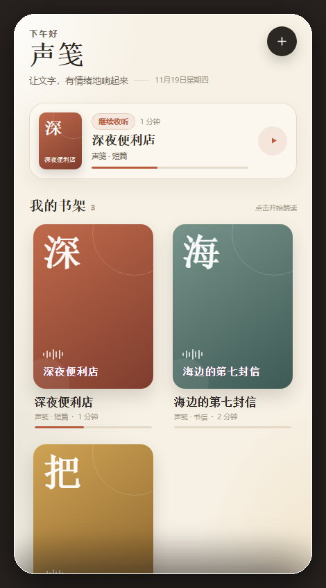
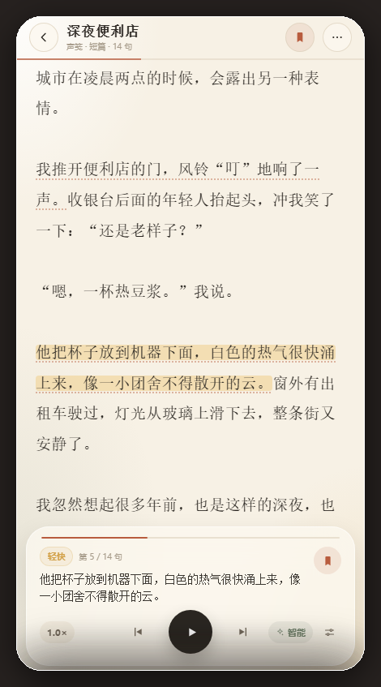
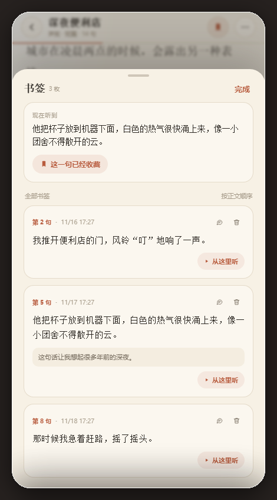

# 声笺 · MoodReader

> 会断句、有情绪、能暂停和收藏书签的 iOS 朗读应用。

| 书架 | 朗读 | 书签 |
| --- | --- | --- |
|  |  |  |

这是一个 **SwiftUI + AVSpeechSynthesizer** 的离线优先实现：不联网也能听，长句会在逗号处换气，每一句会根据标点和语义获得不同的语速、音高、音量和停顿。暂停、继续、上一句、下一句、书签、进度记忆和锁屏控制都已经接好。

---

## 1. 先试一下：浏览器演示

不需要 Mac，也不需要安装任何东西：

```text
双击打开 demo/index.html
```

建议用 Edge / Chrome / Safari。它是和 iOS 版同一套断句、情绪和书签逻辑的网页演示，可以真实听到浏览器自带的中文语音，也可以体验暂停、继续、点击句子跳转、书签和新建文章。

如果浏览器限制本地文件，可以在项目根目录（本机为 `G:\ios阅读器`）启动一个静态服务器：

```bash
cd "G:\ios阅读器"
python -m http.server 8000
```

然后打开 `http://localhost:8000/demo/`。

> 网页版依赖 Web Speech API：音色由浏览器/系统提供，暂停行为在不同浏览器上略有差异；原生 iOS 版使用 AVSpeechSynthesizer，并支持锁屏后继续播放。

演示页支持截图参数，方便预览界面：

```text
?demo=1
?demo=1&view=reader&sentence=4
?demo=1&view=reader&sentence=4&sheet=bookmarks
?demo=1&view=reader&sentence=4&sheet=settings
```

---

## 2. iOS 工程

### 环境

- Xcode 16 或更高版本（工程使用 Xcode 16 的 buildable folder / objectVersion 77）
- iOS 17.0+
- 真机或模拟器

> **没有 Mac？** 在 Windows 11 上照样能编译、能装到自己的 iPhone：编译交给 GitHub Actions 的 macOS 机器（`.github/workflows/ios-build.yml` 已配好），签名和安装用 Sideloadly。完整步骤见 [Docs/Windows11-测试与装机.md](Docs/Windows11-测试与装机.md)；完全没碰过 iOS 的话，直接看 [Docs/手把手-从零装到iPhone.md](Docs/手把手-从零装到iPhone.md)。

### 运行步骤

1. 打开 `MoodReader.xcodeproj`。
2. 选中 **MoodReader** target → **Signing & Capabilities**。
3. 选择自己的 Team；如果没有开发者账号，模拟器可以直接运行。
4. 按需把 `PRODUCT_BUNDLE_IDENTIFIER` 从 `com.moodreader.app` 改成自己的。
5. 选择 iPhone 模拟器或真机，`Cmd + R`。

首次启动会自带三篇原创示例文章；点右上角 `+` 可以粘贴文本或导入 `.txt`（UTF-8 / GB18030 都支持）。

如果 Xcode 打不开 `project.pbxproj`，说明版本低于 16。可以安装 [XcodeGen](https://github.com/yonaskolb/XcodeGen) 后重新生成：

```bash
brew install xcodegen
cd "G:\ios阅读器"
xcodegen generate
```

仓库里同时保留了 `project.yml`，生成结果和现有工程一致。

### 想要更自然的声音

系统语音默认只有“标准”音质。到：

```text
iOS 设置 → 辅助功能 → 朗读内容 → 声音 → 中文
```

下载「增强」或「高级」语音（如婷婷、小晓等），回到 App 的「朗读设置」里选择即可。声音越高级，情绪起伏越自然。

---

## 3. 已实现的功能

| 功能 | 说明 |
| --- | --- |
| 智能断句 | 按句末标点、换行、引号切句；逗号/顿号/冒号处二次切分，让长句有换气 |
| 引号旁白合并 | `“你好。”他说。` 会作为一句整体高亮，不会把“他说。”单独切成一句 |
| 逐句情绪 | 智能模式根据问号、感叹号、省略号、关键词和句长，逐句选择语气 |
| 手动基调 | 温柔、轻快、感伤、郑重、激动、好奇、低语；整篇统一 |
| 语速 | 0.7×–1.4×，可全局调整，也可在播放器上快速切换 |
| 暂停/继续 | 一句话一句话地合成，暂停落在句间也不会丢位置 |
| 上一句/下一句 | 上一句会先回到当前句开头，再按一次才到上一句 |
| 点击正文跳转 | 点任意一句，从那一句开始读 |
| 书签 | 收藏当前句、备注、跳转、删除；按正文顺序保存 |
| 进度记忆 | 退出或杀进程后，下次仍从上次句子继续 |
| 锁屏/后台 | 配置了 `UIBackgroundModes: audio`、`spokenAudio` 音频会话和 Now Playing |
| 导入 | 粘贴文本、导入 txt；自动识别 UTF-8 / GB18030 / UTF-16 |
| 示例内容 | 三篇原创短篇/书信/随笔，足够体验不同语气 |

### 界面结构

- **书架**：继续收听卡片、书籍网格、进度条、新建入口
- **阅读器**：宋体长文、当前句高亮、顶部进度、播放器面板
- **书签**：当前句收藏、备注、按正文排序、跳转
- **朗读设置**：声音、语速、语气、自动滚动

---

## 4. 断句是怎么做的

核心在 `MoodReader/Services/TextSegmenter.swift`，网页版同一套逻辑在 `demo/segmenter.js`，并有单元测试。

规则概览：

1. **句子边界**
   - `。！？；!?;…` 和换行。
   - 英文句号会避开小数（`3.14`）和连续点号（`...`）。
   - 句末的右引号、右括号会跟着上一句一起走。
2. **旁白合并**
   - 如果一句话以右引号结束，后面紧跟不超过 6 个字的短旁白，例如 `“你好。”他说。`，会把旁白并入同句。
   - 这样高亮和书签是一个完整语义单位，但朗读片段仍然可以在引号处停顿。
3. **朗读片段（chunk）**
   - 句子内部在 `，、：` 或破折号处切分，且当前片段至少 14 个字符才切，避免碎成一顿一顿的。
   - 没有标点的超长片段在 64 个字符附近强制切开，优先找空格，避免机器一口气读到缺氧。
4. **位置**
   - 每个句子/片段都保存 UTF-16 的 `NSRange`，用于 UITextView 高亮、点击命中和书签恢复。

一句话在数据里长这样：

```swift
SpeechChunk(
    text: "我推开便利店的门，风铃“叮”地响了一声。",
    range: NSRange(location: 0, length: 24),
    sentenceIndex: 1,
    isSentenceStart: true
)
```

---

## 5. 情绪是怎么来的

核心在 `MoodReader/Models/Emotion.swift`。

`Emotion.auto` 不是“随机换语气”，而是按可解释的规则逐句判断：

| 文本特征 | 语气 |
| --- | --- |
| 问号 + 感伤词 | 感伤 |
| 问号 | 好奇 |
| 感叹号 + 积极/强烈词 | 激动 |
| 感叹号 | 轻快 |
| 省略号 | 温柔 |
| 哭泣、离开、遗憾、夜、雨等 | 感伤 |
| 笑、暖、光、花、喜欢等 | 轻快 |
| 含引号的对白 | 温柔 |
| “终于、竟然、再也”等 | 郑重 |
| 8 字以内短句 | 平静 |
| 其他长句 | 平静/温柔（稳定哈希，避免一条直线） |

每个语气对应一组语速倍率、音高、音量、句后停顿：

```text
温柔：0.90× 语速 / 0.97 音高 / 0.20s 停顿
轻快：1.06× 语速 / 1.10 音高 / 0.10s 停顿
感伤：0.82× 语速 / 0.90 音高 / 0.30s 停顿
激动：1.12× 语速 / 1.15 音高 / 0.08s 停顿
低语：0.76× 语速 / 0.93 音高 / 0.58 音量
```

播放器面板上的小胶囊显示的是 **这一句实际解析出来的情绪**，而右上角的菜单选择的是“整篇基调/智能模式”。

---

## 6. 暂停和书签

### 暂停

`SpeechPlayer` 一次只 `speak` 一个 `SpeechChunk`，在 `didFinish` 后延迟 0.1–0.3 秒再合成下一段。这样：

- `pauseSpeaking(at: .immediate)` 暂停时，不会把后面十几句已经排进队列；
- 暂停后 `continueSpeaking()` 可以原位继续；
- 如果正好停在两句之间的换气延迟里，暂停会把位置推进到下一句，恢复时不会重复上一句；
- 锁屏/来电打断时自动暂停，来电结束后按系统建议恢复。

### 书签

书签不是“记录一个滚动位置”，而是记录：

```swift
struct Bookmark {
    let sentenceIndex: Int   // 第几句
    let charOffset: Int      // UTF-16 字符位置
    let snippet: String      // 原句，列表里直接显示
    let note: String         // 备注
}
```

所以即使之后重新分页、换字号或重开 App，书签仍然能定位。数据保存在 Application Support 的 `library.json`，采用原子写入和 450ms 合并保存，退出/进后台时会立即落盘。

---

## 7. 目录

```text
ios阅读器/                         # 项目根目录（G:\ios阅读器）
├─ MoodReader.xcodeproj/          # 可直接打开的 Xcode 工程
├─ project.yml                    # XcodeGen 备用工程描述
├─ MoodReader/
│  ├─ App/MoodReaderApp.swift
│  ├─ Models/
│  │  ├─ Book.swift               # 书、书签、示例文章
│  │  └─ Emotion.swift            # 情绪预设 + 智能语气规则
│  ├─ Services/
│  │  ├─ LibraryStore.swift       # JSON 持久化、进度、书签
│  │  ├─ SpeechPlayer.swift       # 朗读、暂停、音频会话、锁屏控制
│  │  └─ TextSegmenter.swift      # 断句、片段、UTF-16 Range
│  ├─ Views/
│  │  ├─ LibraryView.swift
│  │  ├─ ReaderView.swift
│  │  ├─ ReaderTextView.swift     # UITextView 高亮/点击/滚动
│  │  ├─ PlayerBar.swift
│  │  ├─ BookmarksSheet.swift
│  │  ├─ VoiceSettingsSheet.swift
│  │  ├─ NewBookSheet.swift
│  │  └─ Theme.swift
│  ├─ Info.plist
│  └─ Resources/
│     └─ Assets.xcassets
├─ demo/                          # 浏览器可运行演示
│  ├─ index.html
│  ├─ styles.css
│  ├─ app.js
│  ├─ segmenter.js                # 与 Swift 同规则的断句/情绪
│  ├─ segmenter.test.js
│  └─ previews/
├─ .github/workflows/ios-build.yml # 云端 macOS 编译，产出未签名 IPA
└─ Docs/
   ├─ CloudVoice.md               # 接入豆包级云端语音的思路
   └─ Windows11-测试与装机.md      # 没有 Mac 时怎么编译、怎么装到 iPhone
```

---

## 8. 验证情况

当前开发环境是 Windows，没有 Xcode，因此这个工程**没有在 iOS 模拟器/真机上实际编译过**。已经完成的验证：

- 所有 14 个 Swift 文件通过 tree-sitter-swift 语法解析，无语法错误节点；
- 断句/情绪规则在 `demo/segmenter.test.js` 中有 10 组断言，全部通过；
- 网页演示通过 jsdom 运行时测试：打开书籍、播放/暂停/继续、书签增删、设置面板、新建文章；
- 预览图由真实 Edge 无头浏览器渲染后截取。

为了让 Windows 也能出包，仓库里补了两样东西：共享 scheme（`xcodebuild -scheme` 需要）和 `.github/workflows/ios-build.yml`（在 GitHub 的 macOS 机器上编译并产出未签名 IPA）。**第一次真实编译的结果以 CI 日志为准**，操作步骤见 [Docs/Windows11-测试与装机.md](Docs/Windows11-测试与装机.md)。

首次在 Xcode 打开时，如果遇到签名、Team、Bundle ID 或 Xcode 版本问题，按第 2 节调整即可。真机运行前请确认：

- Signing Team 已选择；
- `Info.plist` 的 `UIBackgroundModes` 中包含 `audio`；
- 手机没有静音（AVSpeechSynthesizer 走的是播放通道，通常不受静音键影响，但音量需打开）。

---

## 9. 想更接近豆包

需要先说明：**离线系统语音不可能完全达到豆包的音色和情绪表现**。当前版本已经做到“断句自然、逐句有语气、能暂停能书签”，但音色仍然取决于 iOS 系统语音。要明显更接近豆包，需要接云端神经 TTS，例如：

- 火山引擎豆包语音合成（最接近豆包本体）
- Azure Speech（SSML `mstts:express-as`，中文情绪风格完整）
- OpenAI `gpt-4o-mini-tts`（可以用自然语言 instruction 描述语气）

工程已经把“断句”和“播放”拆开了，接入时不需要动阅读器、书签和进度：

1. 保留 `TextSegmenter` 产出的 `SpeechChunk`；
2. 把 `SpeechPlayer.speakCurrentChunk()` 换成“请求云端音频 → 缓存 → AVAudioPlayer 播放”；
3. 把 `Emotion` 映射成云服务的 `style` / `instruction` / `emotion` 参数；
4. 仍然用 `onProgress` 回传句子位置，书签和进度逻辑不变。

更详细的请求示例、SSML 和安全注意事项见 [Docs/CloudVoice.md](Docs/CloudVoice.md)。

---

## 10. 已知限制与下一步

- 当前只用离线系统语音，没有内置云端 TTS；
- 只支持 txt/粘贴，不支持 EPUB、PDF、网页正文抽取；
- 没有睡眠定时、章节、iCloud 同步、CarPlay；
- 阅读字体固定为宋体 19pt，暂未做字号/主题切换；
- iPhone 竖屏优先，未专门适配 iPad 分栏；
- 书签备注在 iOS 上通过列表内编辑，网页演示用原生 prompt。

如果继续做，我建议的顺序是：**云端情绪语音 → 睡眠定时 → 章节/EPUB → iCloud 同步 → 字号与主题**。
